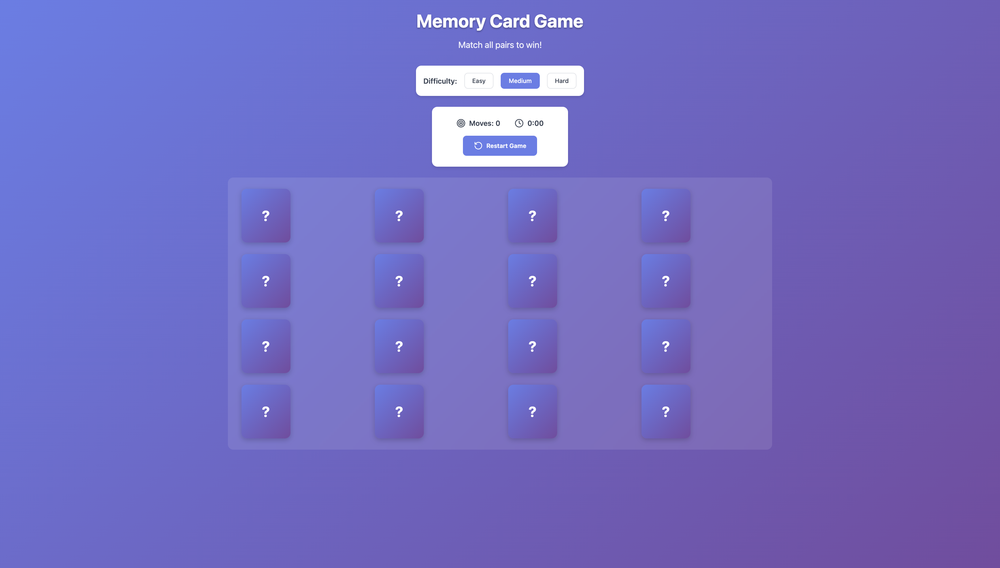
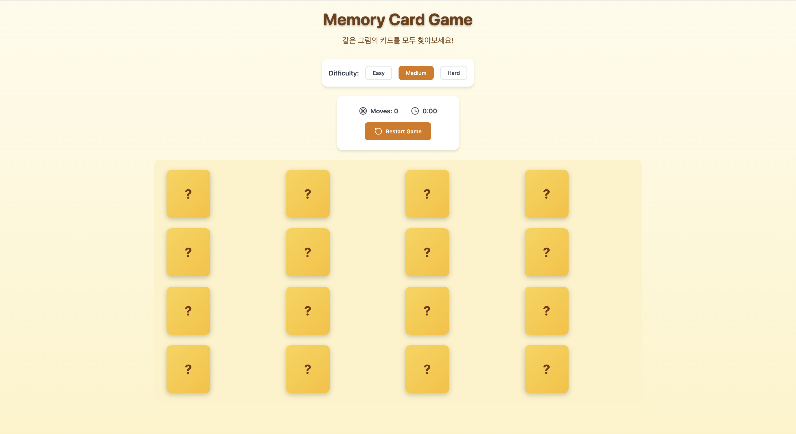

# Assignment 4-2. React Open Source Project Customizing & Deployment

## Project Information: 
- 프로젝트 소개: 뒤집혀있는 카드의 그림을 기억하며 같은 짝을 맞추는 게임
- 선택 이유: 간단한 규칙으로도 재미있게 즐길 수 있는 게임이기도 하고, UI를 개선해보고 싶어서 선택했다.
- 원본 GitHub URL 및 라이선스: https://github.com/sarmientobengjii/memory-game?utm_source=chatgpt.com

## Installation: 
- 설치·실행 방법:
    - git clone https://github.com/sarmientobengjii/memory-game
    - cd memory-card-game
    - npm install
- 실행 화면: 

## Source Code Exploration: 
- 주요 파일
    - `src/App.jsx`: 게임 전체 화면을 만드는 파일이다. 난이도와 최고 기록을 저장하고, 아래 컴포넌트들을 가져와서 배치한다.
    - `src/hooks/useGameLogic.js`: 카드를 만들고 섞고, 카드를 눌렀을 때 짝이 맞는지 확인하는 게임 규칙이 들어 있다.
    - `src/utils/gameConfig.js`: 난이도마다 카드를 몇 줄, 몇 칸으로 놓을지 정해둔 파일이다.
- 컴포넌트
    - `Card.jsx`: 카드 한 장을 보여준다. 카드가 뒤집혔는지, 짝이 맞았는지에 따라 CSS 클래스가 바뀌면서 뒤집히는 효과가 나온다.
    - `GameBoard.jsx`: 난이도에 맞는 줄 수와 칸 수로 카드판을 만들고, `Card`를 카드 수만큼 반복해서 보여준다.
- 코드 분석
- 코드 분석: `useGameLogic.js`에서 카드를 만들고 섞는 부분
    - 전체 카드 수의 절반만큼 그림을 선택하고, 각 그림을 두 번씩 넣어 같은 짝을 만든다.
    - 카드를 무작위로 섞어 화면에 배치한다.
    - Fisher-Yates 셔플 알고리즘을 사용해 카드 순서를 섞는다.

## Customizing: 
- 수정한 3가지 내용
    - Text: 설명 문구를 한글로 변경
    - Style: 보라색 테마를 노란색 계열로 변경
    - UI/Data: Easy 난이도를 2×2(카드 4장)에서 2×3(카드 6장)으로 변경
- 수정 파일명 및 전/후 결과
    - Text: `src/App.jsx`
        - `Match all pairs to win!` -> `같은 그림의 카드를 모두 찾아보세요!`
    - Style: `src/App.css`
        - 보라색 배경, 보라색 버튼, 보라색 카드 뒷면 -> 연한 노란색 배경, 주황색 버튼, 노란색 카드 뒷면
    - UI/Data: `src/utils/gameConfig.js`
        - Easy 2×2 -> Easy 2×3. 테스트 파일도 같이 고쳤다.
- 수정 후 전체 화면

## Deployment
https://memory-game-eight-taupe.vercel.app/

## Weekly Review
- 새롭게 배운 내용 3가지
    - JSX(JavaScript XML): JavaScript 안에서 HTML처럼 UI를 쓰는 문법이다.
    - HTML과 다르게 class는 className으로 쓰고, `<input />`처럼 태그를 꼭 닫아야 한다.
    - 이벤트 속성은 camelCase로 쓴다.
- 어려웠던 점과 해결 방법
    - 처음 보는 프로젝트라 어디부터 읽어야 할지 막막했었다. `App.jsx`에서 시작해서 불러오는 훅과 컴포넌트를 따라 내려가니 흐름이 보였다.
- AI 활용 내용 및 느낀 점
    - React 프로젝트의 구조를 파악하는데 활용했다. 처음보는 파일들이 많아서 헷갈렸지만 주요 파일의 역할과 카드 생성,셔플 등 동작 원리를 이해하는 데 도움을 받았다.